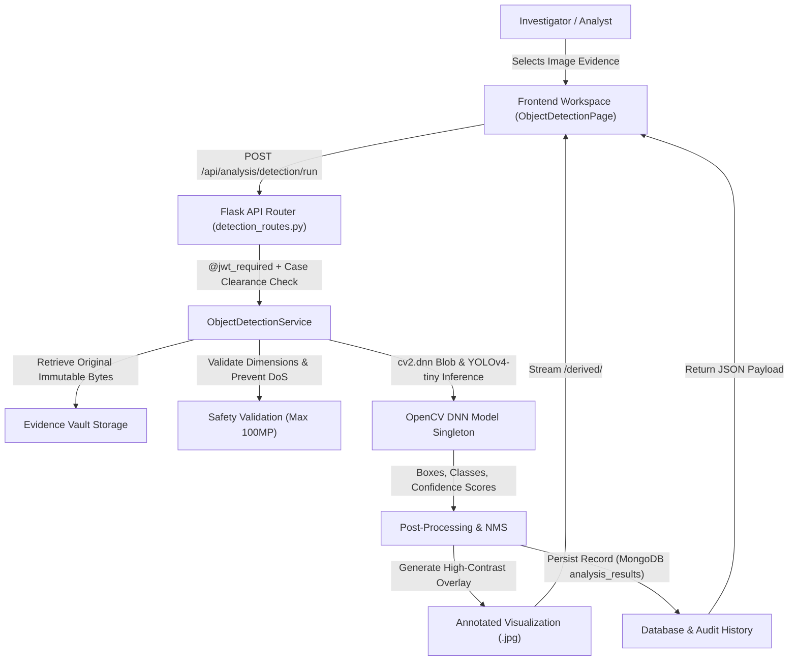

# ForenVision AI Assisted Object Detection Specification

## 1. Executive Summary & Forensic Principles

The **AI-Assisted Object Detection Module** in ForenVision AI provides real, reproducible, deep-learning based visual object localization for verified photographic evidence. The system adheres to strict forensic integrity standards:

1. **Zero-Modification of Evidence**: Original evidence bytes are immutable. The neural network operates strictly on decoded in-memory raster buffers.
2. **Dedicated Working Copies**: All post-processing, bounding box rendering, and visual overlays operate on separate, isolated copies. Derived visualizations are saved separately in `uploads/vault/<case>/derived/` with non-executable (`0o640`) permissions.
3. **No Fabricated Detections or Certainty**: ForenVision AI does **not** mock bounding boxes, fabricate probability values, or generate artificial detections. All outputs represent real neural activations produced by the model.
4. **Non-Culpability Standard**: Automated object detection does **not** establish criminal intent, ownership, illegal activity, or judicial guilt. A detected vehicle, person, or household object provides investigative context only.
5. **Strict Class Boundaries**: The system limits its recognition to the verified 80 MS COCO classes. It does not fabricate detections for unsupported domains (such as specialized firearms, narcotics, or biological traces).

---

## 2. Model Specifications & Documentation

| Attribute | Specification |
| :--- | :--- |
| **Model Name** | YOLOv4-tiny (You Only Look Once, v4 Tiny) |
| **Version** | 4-tiny Darknet release |
| **Source** | Official Darknet Repository by Alexey Bochkovskiy (AlexeyAB) & Joseph Redmon (pjreddie), trained on Microsoft Common Objects in Context (MS COCO) |
| **License** | Open Source / Public Domain (Permissive Unlicense / BSD/MIT style permissive terms; safe for forensic and commercial use without copyleft liabilities) |
| **Architecture** | Convolutional neural network with CSPOS (Cross-Stage Partial connections) and dual YOLO detection heads (`yolo_30`, `yolo_37`) |
| **Model Files** | `backend/models/yolov4-tiny.cfg`, `backend/models/yolov4-tiny.weights` (23.1 MB), `backend/models/coco.names` |
| **Supported Classes** | 80 MS COCO categories |
| **Inference Engine** | OpenCV DNN module (`cv2.dnn.readNetFromDarknet`) targeting CPU with hardware acceleration |
| **Input Tensor** | $416 \times 416$ spatial resolution, normalized pixel values ($1/255.0$ scaling), RGB channel ordering (`swapRB=True`), without cropping |
| **Memory Footprint** | $\approx 24\text{ MB}$ RAM |
| **Typical Latency** | $15 - 35\text{ ms}$ on standard multi-core CPU (Apple Silicon ARM64 / Intel x86_64) |

### 2.1 Supported Class Vocabulary (80 COCO Classes)
- **Vehicles & Transport**: `person`, `bicycle`, `car`, `motorbike`, `aeroplane`, `bus`, `train`, `truck`, `boat`
- **Traffic & Street Furniture**: `traffic light`, `fire hydrant`, `stop sign`, `parking meter`, `bench`
- **Animals**: `bird`, `cat`, `dog`, `horse`, `sheep`, `cow`, `elephant`, `bear`, `zebra`, `giraffe`
- **Personal Accessories**: `backpack`, `umbrella`, `handbag`, `tie`, `suitcase`
- **Sports & Recreation**: `frisbee`, `skis`, `snowboard`, `sports ball`, `kite`, `baseball bat`, `baseball glove`, `skateboard`, `surfboard`, `tennis racket`
- **Kitchenware & Food**: `bottle`, `wine glass`, `cup`, `fork`, `knife`, `spoon`, `bowl`, `banana`, `apple`, `sandwich`, `orange`, `broccoli`, `carrot`, `hot dog`, `pizza`, `donut`, `cake`
- **Furniture & Domestic**: `chair`, `sofa`, `pottedplant`, `bed`, `diningtable`, `toilet`
- **Electronics**: `tvmonitor`, `laptop`, `mouse`, `remote`, `keyboard`, `cell phone`, `microwave`, `oven`, `toaster`, `sink`, `refrigerator`
- **Indoor Objects**: `book`, `clock`, `vase`, `scissors`, `teddy bear`, `hair drier`, `toothbrush`

### 2.2 Known Limitations
1. **Small & Occluded Objects**: Because YOLOv4-tiny uses an optimized lightweight backbone for rapid processing, small or distant objects (e.g. background figures in surveillance footage) have lower recall than heavy ensemble transformers.
2. **No Specialized Contraband/Ballistics Detection**: The model only recognizes standard COCO everyday items. It cannot differentiate between toy replicas and real firearms, nor does it identify narcotics or biological evidence.
3. **Lighting & Distortion**: Low-light noise, heavy motion blur, or severe fisheye lens distortion from security cameras may alter bounding box precision or cause false negatives.
4. **Non-Corroborated Timestamps**: Image timestamps or camera details must be independently verified and not assumed authoritative.

---

## 3. Workflow & Architecture



### 3.1 Security & Access Control
- **Authentication**: All endpoints enforce `@jwt_required`.
- **Case Clearance**: The service queries `case_service.user_can_access_case(user, raw_case)`. If a case is restricted (`is_restricted: True`), only assigned investigators or administrators can execute inference, stream visualizations, or inspect history.
- **Decompression Bomb Protection**: Input images are checked against a ceiling of $10,000 \times 10,000$ pixels and a $100\text{ MP}$ limit.
- **Model Singleton**: The model is loaded into memory once and cached in a thread-safe singleton (`threading.Lock`), avoiding per-request I/O overhead.

---

## 4. API Endpoints

### `GET /api/analysis/detection/model-info`
Returns full model metadata, version, license, supported class list, inference specifications, and known limitations.

### `POST /api/analysis/detection/run`
Executes real neural network inference (`modelId`: `"yolov4-tiny"`, `"forensic-gun-yolov8"`, or `"combined"`) on an authorized evidence item.
- **Request Body**:
  ```json
  {
    "evidenceId": "evd_1a2b3c4d",
    "modelId": "combined",
    "confidenceThreshold": 0.30,
    "nmsThreshold": 0.40,
    "saveAnalysis": true
  }
  ```

### Trained Forensic Firearm & Person Model (`forensic-gun-yolov8`)
- **Dataset**: `datasets/raw/people_with_guns` prepared via `scripts/prepare_gun_dataset.py` into `datasets/prepared/gun_detection/` (`0: person`, `1: gun`).
- **Training Pipeline**: `scripts/train_gun_detector.py` trains YOLOv8n with strict train-only augmentations and exports an OpenCV DNN-compatible ONNX model (`backend/models/forensic_gun_yolov8n.onnx`, `640x640` letterbox RGB, SHA-256 verified in `forensic_gun_metadata.json`).
- **Response**:
  ```json
  {
    "status": "success",
    "data": {
      "id": "det_e7f8a9101112",
      "analysisId": "det_e7f8a9101112",
      "evidenceId": "evd_1a2b3c4d",
      "caseNumber": "CAS-2026-8812",
      "analysisType": "AI Object Detection (YOLOv4-tiny)",
      "summary": {
        "totalObjects": 3,
        "uniqueClasses": 3,
        "classCounts": {"dog": 1, "truck": 1, "bicycle": 1},
        "inferenceLatencyMs": 24.5,
        "imageResolution": "768x576"
      },
      "detectedObjects": [
        {
          "detectionId": "obj_a1b2c3d4",
          "classId": 16,
          "className": "dog",
          "confidence": 0.8702,
          "confidencePercent": 87.0,
          "box": {"x": 137, "y": 205, "width": 182, "height": 336},
          "normalizedBox": {"x": 0.1784, "y": 0.3559, "width": 0.237, "height": 0.5833}
        }
      ],
      "derivedImageUrl": "/api/analysis/detection/derived/det_e7f8a9101112",
      "forensicDisclaimer": "OBJECT DETECTION FORENSIC DISCLAIMER: ... under NO circumstances establish criminal intent, ownership, contraband possession, or legal guilt."
    }
  }
  ```

### `GET /api/analysis/detection/derived/<analysis_id>`
Streams the derived JPEG image with anti-aliased, color-coded bounding boxes and label tags. Enforces case authorization clearances.

### `GET /api/analysis/detection/history/<evidence_id>`
Lists prior object detection runs for an evidence artifact, allowing comparative analysis across different threshold configurations.
