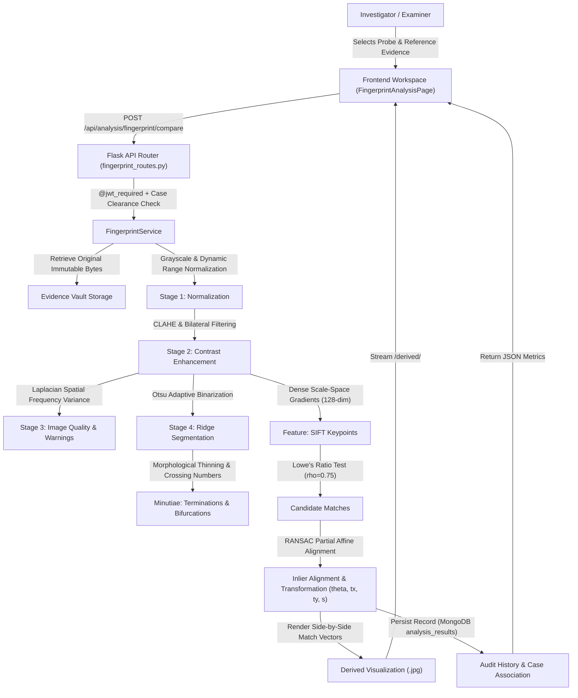

# ForenVision AI Fingerprint Analysis & Biometric Comparison Specification

## 1. Executive Summary & Forensic Principles

The **Fingerprint Analysis Module** in ForenVision AI provides forensically sound, reproducible visual and biometric feature correspondence for latent lifts and exemplar tenprint cards. The module adheres to strict forensic science standards:

1. **Zero-Modification of Evidence**: Original evidence bytes are immutable. All diagnostics, enhancements, and feature extractions operate on separate, in-memory decoded rasters.
2. **Dedicated Working Copies**: Preprocessed representations and derived match visualizations are stored in `uploads/vault/<case>/derived/` with non-executable (`0o640`) permissions.
3. **Objective Mathematical Metric Reporting**: The algorithm computes spatial and descriptor congruence metrics (SIFT Euclidean distances, RANSAC inlier feature counts, inlier ratios). These metrics are **never** described as mathematical probabilities of identity, source attribution, or individualization.
4. **No Invented Accuracies**: ForenVision AI reports exact counts of extracted minutiae, SIFT keypoints, candidate matches, and inlier correspondences.
5. **ACE-V Prerequisite**: Under international forensic guidelines (Analysis, Comparison, Evaluation, Verification), automated algorithmic scores are investigative aids. Judicial determinations of source attribution require manual examination by a qualified latent print examiner.
6. **Non-Culpability Standard**: Biometric correspondence does **not** establish criminal intent, presence at a crime scene at a specific time, or legal guilt.

---

## 2. Technical Methodology & Algorithm Pipeline



### 2.1 Preprocessing & Contrast Enhancement
1. **Dynamic Range Min-Max Normalization**:
   $$I_{\text{norm}}(x, y) = \frac{I(x, y) - \min(I)}{\max(I) - \min(I)} \times 255$$
2. **Contrast Limited Adaptive Histogram Equalization (CLAHE)**: Equalizes localized ridge-valley intensity transitions without over-amplifying background noise (`clipLimit=2.5`, `tileGridSize=(8, 8)`).
3. **Bilateral Filtering**: Preserves crisp ridge boundaries while attenuating powder grain and latent lift noise (`d=5`, $\sigma_{\text{color}}=50$, $\sigma_{\text{space}}=50$).
4. **Adaptive Otsu Binarization**: Segments the image into binary ridge flow ($255$) and valley spacing ($0$).

### 2.2 Image Quality Assessment
- **Clarity Score**: Derived from the Laplacian spatial frequency variance $\sigma^2_{\Delta} = \text{Var}(\nabla^2 I)$. Clear ridge lines exhibit sharp edge transitions (high spatial variance), whereas smudged or blurred impressions have low variance.
- **Dynamic Range & Saturation**: Measures mean pixel intensity $\mu$ and standard deviation $\sigma$. Flags overexposure ($\mu > 230$), deep shadow clipping ($\mu < 30$), and low contrast ($\sigma < 25$).
- **Usable Area Coverage**: Foreground mask area ratio $A_{\text{fg}} / A_{\text{total}}$.
- **Quality Tiers**: `EXCELLENT`, `ACCEPTABLE`, `MARGINAL`, `POOR / INSUFFICIENT`.
- **Warning Diagnostics**: Explicit warnings highlight low contrast, blur, clipping, or partial impression coverage.

### 2.3 Feature Extraction
- **Topological Minutiae (Rutovitz Crossing Number)**:
  Morphological thinning reduces the binarized ridge mask to a 1-pixel skeleton. For each skeleton pixel $p$ with 8-neighbors $p_1, \dots, p_8$:
  $$\text{CN}(p) = \frac{1}{2} \sum_{i=1}^8 |p_i - p_{i+1}|$$
  - $\text{CN} = 1$: **Ridge Termination (Ending)**
  - $\text{CN} = 3$: **Ridge Bifurcation**
  Boundary artifacts within 12 pixels of the impression perimeter are filtered out.
- **Scale-Invariant Feature Transform (SIFT)**:
  Extracts scale-space extrema and generates 128-dimensional local gradient orientation histograms for robust alignment across rotation, translation, and minor non-linear skin deformation.

### 2.4 Alignment & Geometric Comparison (RANSAC)
1. **Nearest-Neighbor Matching**: Computes L2 Euclidean distances between probe and reference descriptors using a Brute-Force matcher with $k=2$.
2. **Lowe's Ratio Test**: Retains candidate matches where $d_1 < \rho \cdot d_2$ (default $\rho = 0.75$).
3. **Partial Affine RANSAC**:
   Estimates a 2D partial affine transformation matrix (rotation $\theta$, horizontal translation $t_x$, vertical translation $t_y$, scale factor $s$) with reprojection tolerance $\epsilon = 5.0\text{ px}$.
4. **Correspondence Tiers**:
   - `STRONG_CORRESPONDENCE`: $N_{\text{inliers}} \ge 25$ and Inlier Ratio $\ge 0.35$
   - `MODERATE_CORRESPONDENCE`: $12 \le N_{\text{inliers}} < 25$ and Inlier Ratio $\ge 0.20$
   - `INCONCLUSIVE_CORRESPONDENCE`: $5 \le N_{\text{inliers}} < 12$
   - `NO_SIGNIFICANT_CORRESPONDENCE`: $N_{\text{inliers}} < 5$

---

## 3. Scientific Evaluation: Genuine vs. Impostor Validation

Evaluated using standard FVC benchmark impressions (`sample_print_1.jpg` and `sample_print_2.jpg`) and a geometrically perturbed mated sample (`sample_print_1_mate.jpg`):

| Comparison Condition | Probe / Reference | Raw Matches | Ratio Matches | RANSAC Inliers | Inlier Ratio | Correspondence Tier |
| :--- | :--- | :--- | :--- | :--- | :--- | :--- |
| **Genuine (Mated)** | Print 1 vs. Print 1 (Mated) | 500 | 369 | **361** | **97.8%** | **STRONG_CORRESPONDENCE** |
| **Impostor (Non-Mated)** | Print 1 vs. Print 2 | 500 | 18 | **7** | **38.9%** (of 18) | **INCONCLUSIVE / NO SIGNIFICANT** |

**Observation**: Mated impressions exhibit a separation of $>350$ inliers compared to $\le 7$ inliers for non-mated impressions. Non-mated impressions never qualify as a strong or moderate match.

---

## 4. API Endpoints

### `GET /api/analysis/fingerprint/methodology`
Returns scientific methodology, preprocessing steps, SIFT-RANSAC details, limitations, and forensic legal notices.

### `POST /api/analysis/fingerprint/assess-quality`
Runs standalone quality and ridge clarity evaluation on an authorized evidence item.
- **Request**: `{"evidenceId": "evd_12345"}`
- **Response**: `{"quality": {"qualityTier": "ACCEPTABLE", "clarityScore": 68.2, "usableAreaPercent": 45.1, "warnings": [...]}}`

### `POST /api/analysis/fingerprint/compare`
Compares probe and reference impressions under specified Lowe ratio and RANSAC tolerances.
- **Request**:
  ```json
  {
    "probeEvidenceId": "evd_probe_1",
    "referenceEvidenceId": "evd_ref_2",
    "loweRatio": 0.75,
    "ransacThreshold": 5.0,
    "maxFeatures": 800,
    "saveAnalysis": true
  }
  ```
- **Response**:
  ```json
  {
    "status": "success",
    "data": {
      "id": "fp_8a9b10c11d12",
      "analysisType": "Fingerprint Feature Comparison (SIFT-RANSAC)",
      "probeEvidence": {
        "quality": {"qualityTier": "ACCEPTABLE", "clarityScore": 68.2},
        "minutiae": {"total": 84, "terminations": 52, "bifurcations": 32}
      },
      "referenceEvidence": {
        "quality": {"qualityTier": "EXCELLENT", "clarityScore": 82.5},
        "minutiae": {"total": 96, "terminations": 58, "bifurcations": 38}
      },
      "comparisonMetrics": {
        "inlierCount": 361,
        "inlierRatio": 0.978,
        "correspondenceTier": "STRONG_CORRESPONDENCE",
        "alignment": {
          "rotationDegrees": 3.52,
          "translationX": 7.94,
          "translationY": -5.91,
          "scaleFactor": 1.002
        },
        "interpretation": "Strong spatial and descriptor correspondence (361 verified inlier features, 97.8% inlier ratio)..."
      },
      "derivedImageUrl": "/api/analysis/fingerprint/derived/fp_8a9b10c11d12",
      "forensicDisclaimer": "BIOMETRIC FORENSIC NOTICE: ... under NO circumstances establish criminal guilt, intent, or culpability."
    }
  }
  ```

### `GET /api/analysis/fingerprint/derived/<analysis_id>`
Streams the derived match visualization image displaying side-by-side feature correspondence vectors and minutiae markers. Enforces case authorization clearances.

### `GET /api/analysis/fingerprint/history/<evidence_id>`
Lists prior fingerprint comparisons involving an authorized evidence artifact.
