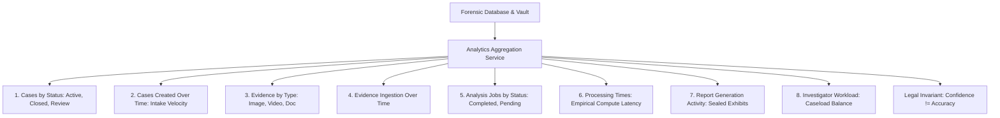

# ForenVision AI: Forensic Operations Analytics & Telemetry Specification

## 1. Executive Summary & Legal Principles

The **Forensic Operations Analytics & Telemetry Module** computes database-backed operational metrics across investigation dockets, evidence vault records, automated AI diagnostic pipelines, and sealed court exhibit dossiers.

### Core Forensic Invariants
1. **Zero Fabrication**: All metrics reflect empirical database records. If a dataset is empty or no processing durations have been logged, the module returns explicit zero counts (`0`) or empty structures (`[]`). No synthetic placeholders or mock distributions are generated.
2. **Confidentiality & Access Control**: Metrics respect case-level access controls. Non-admin users only view aggregated counts for cases they are cleared to access; restricted cases they cannot access are completely excluded from their metrics.
3. **Personnel Workload Privacy**: Anonymized workload breakdowns across all examiners are restricted to administrative and supervisory personnel. Standard examiners receive only their authorized individual caseload metrics. Case titles and sensitive suspect details are never disclosed.
4. **Separation of Confidence vs. Accuracy**: Model confidence scores (e.g. YOLO bounding box probabilities or facial embedding similarities) represent mathematical pattern correspondence under training parameters. Under **OSAC**, **NIST**, and **Federal Rules of Evidence (FRE 702 / Daubert)**, algorithmic confidence NEVER equates to forensic accuracy, identity certainty, or autonomous legal proof of guilt.

---

## 2. Database Aggregations & Indexes

### Supported Collections & Indexed Fields

| Collection | Indexed Fields | Purpose |
|---|---|---|
| `cases` | `status`, `createdAt`, `leadInvestigator`, `assignedExaminers`, `is_restricted`, `("status", "createdAt")` | Case status breakdown and casework intake velocity over time |
| `evidence` | `type`, `uploadedAt`, `("type", "uploadedAt")`, `caseId`, `detectedMediaType` | Media type distribution and daily ingestion trajectories |
| `analysis_results` | `status`, `category`, `timestamp`, `createdAt`, `processingTimeMs`, `model` | Job lifecycle states and empirical compute latency benchmarks |
| `forensic_reports` | `createdAt`, `classification`, `caseId`, `author.id` | Court dossier compilation volume and classification balance |

---

## 3. Metrics Specification

### 1. Cases by Status
- Counts authorized cases grouped by administrative status (`ACTIVE`, `OPEN`, `IN_PROGRESS`, `UNDER_REVIEW`, `CLOSED`, `ARCHIVED`, `COLD`).
- Visualized as colored bar distributions reflecting caseload balance.

### 2. Cases Created Over Time
- Chronological trajectory of case intakes initiated within the designated calendar window (grouped by date `YYYY-MM-DD`).
- Visualized as an interactive area chart with gradient fills.

### 3. Evidence by Type
- Categorization of physical and digital exhibits ingested into the vault by MIME media type (`image`, `video`, `audio`, `document`, `pdf`, `binary`).

### 4. Evidence Ingestion Over Time
- Daily intake velocity tracking the chronological volume of evidence exhibits registered and hashed upon vault ingestion.

### 5. Analysis Jobs by Status
- Lifecycle execution states (`completed`, `pending`, `failed`, `in_progress`) across automated diagnostic engines (EXIF/ELA, YOLO, SIFT-RANSAC, Face Metric, Witness Sketch).

### 6. Processing Times When Recorded
- Empirical compute execution elapsed times in milliseconds recorded during model inference or algorithmic processing:
  - `overallAvgMs`, `overallMinMs`, `overallMaxMs`
  - Granular breakdown per forensic module (Image Forensics ELA, YOLO Scene Detection, SIFT-RANSAC, Face Verification, Witness Sketch Morphology).
  - Explicit `available: false` and empty state when unrecorded.

### 7. Report-Generation Activity
- Volume of official court exhibit dossiers compiled and sealed with SHA-256 digital digests, categorized by evidentiary classification tier (`OFFICIAL COURT EXHIBIT`, `CONFIDENTIAL`, `RESTRICTED`).

### 8. Investigator Workload (Protected with RBAC)
- Caseload allocation (active cases, closed cases, total assigned) per certified examiner.
- **Admin / Supervisory Role**: Full personnel breakdown (`scope: "ALL_PERSONNEL"`).
- **Standard Investigator / Analyst**: Restricted to individual caseload (`scope: "PERSONAL_ONLY"`).
- Sanitized to prevent operational disclosure (zero exposure of confidential case titles or suspect details).

---

## 4. REST API Specification

### `GET /api/analytics/overview`
- **Auth**: JWT required.
- **Query Parameters**:
  - `range`: `'7d' | '30d' | '90d' | '1y' | 'all'` (default: `'30d'`).
  - `startDate`: ISO 8601 string (`YYYY-MM-DD` or full ISO).
  - `endDate`: ISO 8601 string (`YYYY-MM-DD` or full ISO).
- **Response**: `200 OK` with JSON object containing all 8 metrics, date range metadata, and formal metric definitions.

### `GET /api/analytics/workload`
- **Auth**: JWT required.
- **Response**: `200 OK` with workload breakdown and authorization scope.

### `GET /api/analytics/definitions`
- **Auth**: JWT required.
- **Response**: `200 OK` with standardized glossary and statutory legal notice.
