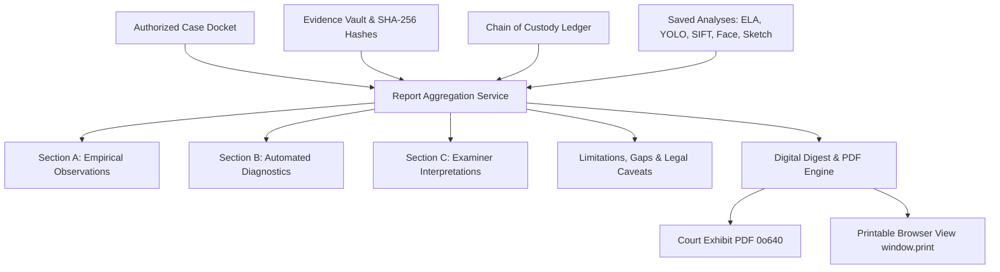

# ForenVision AI: Forensic Reporting & Court Exhibit Dossier Specification

## 1. Executive Summary & Legal Principles

The **Forensic Reporting & Court Exhibit Dossier Module** compiles authenticated forensic evidence records, chain-of-custody timelines, and multi-modal AI diagnostics into court-admissible, cryptographically sealed PDF documents and interactive printable views.

### Core Forensic Invariants
1. **Zero Fabrication**: Reports use only verified, real database and evidence vault records. Missing data or unexecuted analytical modules are never supplemented with synthetic placeholders or fabricated statistics.
2. **Strict Perspective Separation**:
   - **Section A (Objective Physical & Digital Observations)**: Empirical evidence inventory with cryptographic SHA-256 digests and immutable custody transfer event logs.
   - **Section B (Automated Algorithmic Diagnostic Outputs)**: Model predictions, parameter settings, and mathematical pattern correspondence tiers (Image Forensics, YOLO Object Detection, Fingerprint SIFT-RANSAC, Face Metric Verification, and Witness Sketch Review).
   - **Section C (Investigator Interpretations & Review Notes)**: Examiner qualitative review notes, synthesis, and ACE-V (Analysis, Comparison, Evaluation, Verification) methodology affirmations.
3. **Selective Module Inclusion**: Advanced biometric and experimental modules (Fingerprint comparison, Facial metric verification, and Witness sketch review) appear **ONLY** when actual analysis results exist on the case docket.
4. **Transparent Limitation & Integrity Gaps**: All data deficiencies (missing EXIF, unhashed files, resolution disparities, or qualitative constraints under Daubert/Frye criteria) are explicitly audited.
5. **Enforced Access Control**: Report compilation, metadata retrieval, and PDF downloads enforce strict case-level RBAC (Admin, Lead Investigator, Assigned Examiners). Direct public links to evidence or PDF exhibits are barred.

---

## 2. PDF Engine Selection: ReportLab 5.0.1

### Rationale
- **Cross-Platform Determinism**: Pure Python with C-extension acceleration; runs natively across macOS (Apple Silicon / Intel) and Linux production containers without external GTK, Pango, or headless browser daemons (e.g., avoiding the heavy overhead of WeasyPrint or Puppeteer).
- **Court Exhibit Formatting**: Enables high-precision millimeter typographic controls, running running headers with dynamic case identifiers, running footers with page counters (`Page X of Y`), docket classification banners, and cryptographic digital digest blocks.
- **Security & Storage Integrity**: Generated PDFs are persisted non-executably (`0o640`) in the case vault:
  ```
  uploads/vault/<case_number>/reports/<report_id>.pdf
  ```
  with immediate SHA-256 binary digest generation recorded in the database audit log.

---

## 3. Dossier Structure & Schema



### JSON Record Schema (`forensic_reports`)

| Field | Type | Description |
|---|---|---|
| `reportId` / `id` | String | Unique exhibit identifier (`REP-YYYY-UUID`) |
| `reportVersion` | String | Semantic version (`v1.0`, incremented per compilation) |
| `classification` | String | Evidentiary tier (`OFFICIAL COURT EXHIBIT`, `CONFIDENTIAL`, `RESTRICTED`) |
| `caseId` / `caseNumber` | String | Associated investigation docket |
| `caseMetadata` | Object | Docket title, status, incident type, priority, timestamps |
| `evidenceInventory` | Array | Ingested items with filename, type, size, and SHA-256 hash |
| `chainOfCustody` | Array | Chronological transaction events, acting officers, and notes |
| `analyses` | Object | Module results (selective inclusion) |
| `sectionA_observations` | Object | Formatted empirical facts & evidence table |
| `sectionB_automated_diagnostics` | Object | Algorithmic runs with model versions and parameters |
| `sectionC_investigator_interpretations` | Object | Examiner synthesis and ACE-V methodology statement |
| `limitationsAndGaps` | Object | Data gaps and mathematical boundary disclaimers |
| `digitalDigest` | Object | `sha256_metadata`, `sha256_pdf`, and ISO UTC timestamp |
| `pdf` | Object | File size in bytes, filename, and vault storage digest |

---

## 4. REST API Specification

### 1. `GET /api/reports`
- **Auth**: JWT required.
- **Parameters**: `caseId` or `caseNumber` (optional filter).
- **RBAC**: Returns only reports belonging to cases the user is authorized to access.

### 2. `POST /api/reports/generate`
- **Auth**: JWT required (Admin, Investigator, Analyst).
- **Body**:
  ```json
  {
    "caseId": "60d5ec49f1b2c8a1d8f8a123",
    "title": "Comprehensive Exhibit Dossier — Operation Apex Ledger",
    "classification": "OFFICIAL COURT EXHIBIT",
    "investigatorNotes": "Corroborated altered ledger scan against recovered storage timestamps."
  }
  ```
- **Response**: `201 Created` with sealed report record and `digitalDigest`.

### 3. `GET /api/reports/<report_id>`
- **Auth**: JWT required.
- **RBAC**: Checks case-level assignment. Returns `403 Forbidden` if unauthorized.

### 4. `GET /api/reports/<report_id>/pdf?download=true`
- **Auth**: JWT required.
- **Output**: Binary stream (`application/pdf`) with `Content-Disposition: attachment; filename="<report_id>_dossier.pdf"`.
- **Integrity**: Streamed bytes exactly match `digitalDigest.sha256_pdf`.

### 5. `GET /api/reports/<report_id>/preview`
- **Auth**: JWT required.
- **Output**: Formatted document for interactive browser rendering and `window.print()`.

---

## 5. Daubert / Frye Legal Caveat Block

All generated exhibits embed the statutory notice:
> **FORENSIC REPORT NOTICE & LEGAL INVARIANTS**: This examination dossier compiles verified objective evidence records, immutable custody transactions, and algorithmic diagnostic outputs generated by ForenVision AI. Automated model outputs (including object detections, SIFT-RANSAC feature alignments, and neural facial embeddings) represent mathematical pattern correspondence in digital representations and under NO circumstances constitute autonomous legal proof of identity, individualization, presence, or guilt. Automated results do NOT accuse individuals or label subjects as suspects. In accordance with forensic science standards (OSAC, NIST, and ENFSI), all diagnostic findings require independent verification by a qualified forensic examiner under the ACE-V (Analysis, Comparison, Evaluation, Verification) methodology before court presentation.
