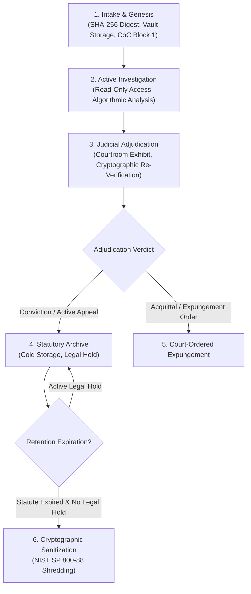

# ForenVision AI Forensic Evidence Retention & Lifecycle Policy

## 1. Regulatory & Standards Alignment

This policy governs the intake, active investigation, archival, and disposal of digital forensic evidence within ForenVision AI in compliance with:
- **FBI CJIS Security Policy v5.9**: Security controls for Criminal Justice Information (CJI).
- **ISO/IEC 27037:2012**: Guidelines for identification, collection, acquisition, and preservation of digital evidence.
- **NIST SP 800-86**: Guide to Integrating Forensic Techniques into Incident Response.
- **NIST SP 800-88 Rev. 1**: Guidelines for Media Sanitization.

---

## 2. Evidence Lifecycle Model

---

## 3. Retention Schedules by Case Classification

| Offense / Docket Category | Active Investigation | Post-Adjudication Archival | Total Mandatory Retention |
| :--- | :--- | :--- | :--- |
| **Homicide / Capital Offense / Missing Persons** | Indefinite until resolved | Indefinite / Permanent | **Permanent (Never Purged)** |
| **Major Violent Felony / Sexual Assault** | Duration of case | 30 years post-release | **Sentence + 30 Years** |
| **Property Crime / Grand Theft / Fraud** | Duration of case | 10 years post-disposition | **10 Years Post-Closing** |
| **Misdemeanor / Minor Infraction** | Duration of case | 5 years post-disposition | **5 Years Post-Closing** |
| **Internal Affairs / Administrative Inquiry** | Duration of case | 7 years post-disposition | **7 Years Post-Closing** |

---

## 4. Operational Invariants

### 4.1. Immutability of Original Media
- Original evidence files written to the private vault ([`uploads/vault/`](file:///Users/abir/Coding/Forenvision/backend/uploads/vault)) receive Unix file mode `0640` and are owned by an unprivileged system user.
- Original files are **NEVER modified, re-compressed, or overwritten** by any forensic tool (Error Level Analysis, YOLOv4-tiny, or SIFT). All derivative files are written to [`uploads/derived/`](file:///Users/abir/Coding/Forenvision/backend/uploads/derived).

### 4.2. Chain of Custody Permanence
- Chain-of-custody blocks ([`chain_of_custody` collection](file:///Users/abir/Coding/Forenvision/docs/DATABASE_INDEXES.md#24-chain_of_custody-collection)) are immutable cryptographic records.
- **Custody entries are NEVER deleted**, even when original evidence files are legally expunged or shredded. When an artifact is purged, a final `destroyed` or `expunged` block is appended to record legal compliance.

### 4.3. Legal Holds
- Any authorized Administrator or Investigator can place a **Legal Hold** on a case docket.
- An active legal hold freezes all automated purging mechanisms, overriding standard expiration schedules.

---

## 5. Media Sanitization & Destruction (NIST SP 800-88 Rev. 1)

When the statutory retention period has expired and no active legal hold exists, evidence destruction must follow strict cryptographic sanitization procedures:

1. **Destruction Authorization**: Requires documented sign-off by the Lead Investigator and Evidence Custodian.
2. **Cryptographic Erasure / Overwrite**:
   - For block storage volumes: 3-pass cryptographic wipe (DoD 5220.22-M) or deletion of the volume encryption key (Cryptographic Shredding per NIST SP 800-88).
   - For file-level deletion: Secure deletion utility (`shred -u -z -n 3 <filepath>`).
3. **Audit Log & Certificate of Destruction**:
   - The deletion event is permanently recorded in the `audit_logs` collection with:
     - Target evidence number and SHA-256 digest.
     - Authorizing officer and credential badge.
     - Timestamp and legal disposition reference.
     - Method of destruction.
